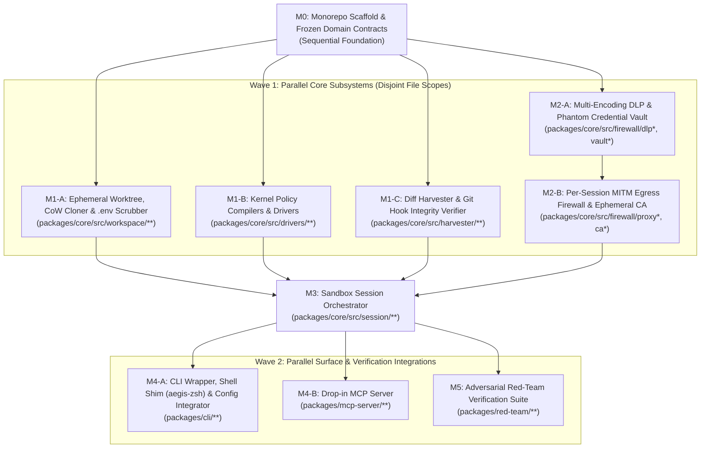

# Aurora-Aegis (`aegis`) — AI-Agent Execution Milestones & DAG

> [!NOTE]
> **Designed for Autonomous Coding Agents & Parallel Swarms**: Every milestone and step below is engineered for AI agent execution rather than human sprint planning. Each step specifies **DAG Dependencies**, **Strict File Ownership Boundaries** (preventing merge conflicts across parallel subagents), **Frozen TypeScript Contracts**, and **Deterministic Self-Verification Commands** (zero human-in-the-loop required).

---

## 1. Execution Dependency Graph (Agent Swarm Topology)

After **Milestone 0** freezes the monorepo scaffold and `contracts.ts`, **Milestones 1 and 2** can be executed concurrently by up to 5 parallel worker agents with zero file contention.



---

## 2. Agent Execution Rules

1. **Contract-First Immutability**: Once `M0.2` completes, no worker agent in Wave 1 may modify `packages/core/src/types/contracts.ts` without coordinator approval.
2. **Strict File Ownership**: Agents must only create or edit files listed under their step's `Owned Paths`.
3. **Canonical Path Invariant**: Every filesystem path passed to Git, Seatbelt, or `bubblewrap` must pass through `canonicalizePath(p)` (`fs.realpathSync`).
4. **Deterministic Gate**: A step is complete **only** when `pnpm typecheck` and the step's specific `Verification Command` exit with code `0`.
5. **Zero Tautological Tests or Comments**: Never write comments that restate the code/identifier or tests that only assert mocked/input values equal themselves. Enforced automatically by `packages/red-team/test/anti-tautology.test.ts`.

---

## Milestone 0: Monorepo Foundation & Frozen Domain Contracts

### Step `M0.1`: Initialize pnpm Monorepo, TypeScript Strict Build & Vitest Runner
* **Depends On**: None
* **Execution Mode**: Single Agent
* **Owned Paths**:
  * `package.json`, `pnpm-workspace.yaml`, `tsconfig.base.json`, `vitest.config.ts`, `.gitignore`
  * `packages/core/package.json`, `packages/core/tsconfig.json`
  * `packages/cli/package.json`, `packages/cli/tsconfig.json`
  * `packages/mcp-server/package.json`, `packages/mcp-server/tsconfig.json`
  * `packages/red-team/package.json`, `packages/red-team/tsconfig.json`
* **Implementation Spec**:
  * Configure Node `>=22`, ESM (`"type": "module"`), TypeScript `5.x` with `"strict": true`, `"noUncheckedIndexedAccess": true`, and `vitest` for fast unit/integration execution.
* **Verification Command**:
  ```bash
  pnpm install && pnpm -r typecheck
  ```

### Step `M0.2`: Author Canonical Domain Contracts & Path Canonicalizer
* **Depends On**: `M0.1`
* **Execution Mode**: Single Agent
* **Read Context**: `GLOSSARY.md`, `docs/ARCHITECTURE.md`
* **Owned Paths**:
  * `packages/core/src/types/contracts.ts`
  * `packages/core/src/utils/paths.ts`
  * `packages/core/src/index.ts`
  * `packages/core/test/paths.test.ts`
* **Implementation Spec**:
  * Define all domain interfaces (`IsolationTier`, `SandboxPolicy`, `EgressDomainRule`, `PhantomCredentialRule`, `SecretFingerprint`, `CommandResult`, `DlpViolationEvent`, `WorkspaceDescriptor`, `SandboxDriver`, `HarvestResult`).
  * Implement `canonicalizePath(targetPath: string): string` resolving symlinks (handling non-existent leaf paths by canonicalizing the nearest existing ancestor directory and appending the normalized relative tail—critical for macOS `/tmp` -> `/private/tmp`).
* **Verification Command**:
  ```bash
  pnpm --filter @aegis/core test test/paths.test.ts
  ```

---

## Milestone 1: Workspace Lifecycle, CoW Engine & Kernel Drivers (Wave 1 — Parallelizable)

### Step `M1-A.1`: Ephemeral Worktree Manager & CoW Dependency Cloner
* **Depends On**: `M0.2`
* **Execution Mode**: Parallel Worker 1
* **Read Context**: `docs/adr/0003-default-deny-home-and-git-hook-write-protection.md`, `packages/core/src/types/contracts.ts`
* **Owned Paths**:
  * `packages/core/src/workspace/worktree-manager.ts`
  * `packages/core/src/workspace/cow-cloner.ts`
  * `packages/core/test/workspace/worktree-cow.test.ts`
* **Implementation Spec**:
  * `EphemeralWorktreeManager.create(repoRoot, sessionId)`:
    * Resolves canonical repo path and `.git` directory.
    * Selects worktree base directory on the **same filesystem mount** as `repoRoot` (ensuring APFS `cp -cR` and Linux `cp --reflink=always` succeed without cross-device `EXDEV` failures).
    * Runs `git worktree add --detach <worktreePath> HEAD`.
    * Extracts exact `worktreeGitDir` (`<repoRoot>/.git/worktrees/<name>`).
  * `CoWCloner.cloneDirectories(repoRoot, worktreePath, dirs)`:
    * Detects OS & filesystem support (`cp -cR` on darwin, `cp -a --reflink=always` with fallback to `--reflink=auto` on linux).
    * Clones configured heavy directories (`node_modules`, `.venv`, `target`) into `worktreePath` without following symlinks outside `repoRoot`.
* **Verification Command**:
  ```bash
  pnpm --filter @aegis/core test test/workspace/worktree-cow.test.ts
  ```

### Step `M1-A.2`: Worktree `.env` Scrubber, Zero-Trust `process.env` Sanitizer & Canary Honeytoken Planter
* **Depends On**: `M1-A.1`
* **Execution Mode**: Parallel Worker 1
* **Read Context**: `docs/adr/0007-active-secret-defense-ipc-lockdown-and-canaries.md`
* **Owned Paths**:
  * `packages/core/src/workspace/env-scrubber.ts`
  * `packages/core/src/workspace/canary-planter.ts`
  * `packages/core/test/workspace/env-scrubber.test.ts`
* **Implementation Spec**:
  * Scans `repoRoot` for `.env`, `.env.local`, `.env.development`, `.npmrc`.
  * Parses secret key-value pairs in the Control Plane, generates `PhantomCredentialRule` entries (`aegis_phantom_<key>_<randomHex>`), and writes a sanitized `.env` inside the `EphemeralWorktree` containing only Phantom Credentials so the real values never touch the worktree disk.
  * Implements `sanitizeProcessEnv(hostEnv)`: strips `SSH_AUTH_SOCK`, `GPG_AGENT_INFO`, `DOCKER_HOST`, and any inherited `*_KEY`, `*_TOKEN`, `*_SECRET`, `*_PASSWORD`, `DATABASE_URL` variables, passing only an explicit structural allowlist into the Execution Plane.
  * Implements `CanaryPlanter`: plants high-enticement **Canary Honeytokens** inside `$SESSION_HOME/.aws/credentials` and `$SESSION_HOME/.ssh/id_ed25519` and registers their 6-character sliding substrings as tripwires.
* **Verification Command**:
  ```bash
  pnpm --filter @aegis/core test test/workspace/env-scrubber.test.ts
  ```

### Step `M1-B.1`: macOS Seatbelt (`sandbox-exec`) Policy Compiler & Driver
* **Depends On**: `M0.2`
* **Execution Mode**: Parallel Worker 2
* **Read Context**: `docs/ARCHITECTURE.md#31-tier-1-macos-seatbelt-sandbox-exec-hardened-profile`, `docs/adr/0003-default-deny-home-and-git-hook-write-protection.md`
* **Owned Paths**:
  * `packages/core/src/drivers/seatbelt-compiler.ts`
  * `packages/core/src/drivers/seatbelt-driver.ts`
  * `packages/core/test/drivers/seatbelt.test.ts`
* **Implementation Spec**:
  * `compileSeatbeltProfile(policy, workspace, proxyPort)`: Pure function returning deterministic SBPL `.sb` string enforcing:
    1. Default-Deny `file-read*` and `file-write*` on canonical `$HOME`.
    2. Explicit read-only allowlist for canonical toolchain paths.
    3. Default-Deny `file-write*` globally; allow `file-write*` only in `worktreePath`, `sessionTmpDir`, `/dev/null`, `/dev/tty`, `/dev/zero`, `/dev/random`, `/dev/urandom`.
    4. **Git Hook Guard**: Allow `file-write*` to `worktreeGitDir` and `<repoGit>/objects`, explicitly `deny file-write*` on `<repoGit>/hooks`, `<repoGit>/config`, `<repoGit>/packed-refs`, `<repoGit>/refs/heads`.
    5. `(deny network*)` with `(allow network-outbound (remote tcp "localhost:<proxyPort>"))`.
  * `SeatbeltDriver.exec(cmd, env)`: Spawns `/usr/bin/sandbox-exec -f <profilePath> /bin/zsh -c <cmd>` with scrubbed environment variables and proxy CA cert injection.
* **Verification Command**:
  ```bash
  pnpm --filter @aegis/core test test/drivers/seatbelt.test.ts
  ```

### Step `M1-B.2`: Linux `bubblewrap` + `seccomp-bpf` + UDS Bridge Driver & Tier 2 MicroVM Adapter
* **Depends On**: `M0.2`
* **Execution Mode**: Parallel Worker 2
* **Read Context**: `docs/adr/0002-dual-tier-kernel-mac-and-microvm-isolation.md`, `docs/adr/0006-unix-socket-bridge-for-linux-netns-egress.md`
* **Owned Paths**:
  * `packages/core/src/drivers/bwrap-compiler.ts`
  * `packages/core/src/drivers/bwrap-driver.ts`
  * `packages/core/src/drivers/uds-bridge.ts`
  * `packages/core/src/drivers/microvm-driver.ts`
  * `packages/core/test/drivers/bwrap-microvm.test.ts`
* **Implementation Spec**:
  * `compileBwrapArgs(policy, workspace, udsSocketPath)`: Produces argument array for `bwrap --unshare-all --die-with-parent`, mounting `--tmpfs $HOME`, read-only toolchain mounts, read-write `worktreePath`, and read-only overlays on `<repoGit>/hooks` and `<repoGit>/config`.
  * `uds-bridge.ts`: Lightweight Node TCP-to-Unix-Domain-Socket forwarder (`127.0.0.1:<proxyPort>` -> `/run/aegis/egress.sock`) so `--unshare-net` processes on Linux can use `HTTP_PROXY=http://127.0.0.1:<proxyPort>`.
  * `MicroVMDriver`: Tier 2 driver interface supporting `vfkit` (macOS) and `firecracker` (Linux) over `virtio-vsock`.
* **Verification Command**:
  ```bash
  pnpm --filter @aegis/core test test/drivers/bwrap-microvm.test.ts
  ```

### Step `M1-C.1`: Diff Harvester, Git Hook Integrity Verifier & Pre-Harvest Persistence Scanner
* **Depends On**: `M0.2`
* **Execution Mode**: Parallel Worker 3
* **Read Context**: `docs/adr/0007-active-secret-defense-ipc-lockdown-and-canaries.md`
* **Owned Paths**:
  * `packages/core/src/harvester/diff-harvester.ts`
  * `packages/core/src/harvester/hook-verifier.ts`
  * `packages/core/src/harvester/persistence-scanner.ts`
  * `packages/core/test/harvester/harvester.test.ts`
* **Implementation Spec**:
  * `GitHookIntegrityVerifier`: Before session start and before harvesting, hashes all files in `<repoGit>/hooks`, `<repoGit>/config`, and `<repoGit>/refs/heads/*` (SHA-256) to prove zero tampering occurred.
  * `PersistenceScanner`: Inspects the worktree diff for delayed host-execution **Persistence Vectors** (`.gitattributes` filter drivers, `.gitmodules`, `.vscode/tasks.json`, `.vscode/settings.json`, `.idea/*`, `package.json` `preinstall`/`postinstall`, `Cargo.toml` `build.rs`) and blocks silent auto-harvesting when trojaned triggers are detected.
  * `DiffHarvester`: Extracts uncommitted and committed changes from the `EphemeralWorktree` as a clean Git patch or branch ref, checks for forbidden binary bloat or leaked Phantom Credential strings (`aegis_phantom_*`) in the diff before applying to the host repository, and tears down the worktree cleanly.
* **Verification Command**:
  ```bash
  pnpm --filter @aegis/core test test/harvester/harvester.test.ts
  ```

---

## Milestone 2: Multi-Encoding DLP Engine, Phantom Vault & Egress Firewall (Wave 1 — Parallelizable)

### Step `M2-A.1`: Multi-Encoding Secret Fingerprinter, Decompressor & DLP Scanner
* **Depends On**: `M0.2`
* **Execution Mode**: Parallel Worker 4
* **Read Context**: `docs/ARCHITECTURE.md#5-egress-firewall-multi-encoding-dlp--phantom-credential-swap`, `docs/adr/0004-loopback-mitm-egress-dlp-and-phantom-credentials.md`
* **Owned Paths**:
  * `packages/core/src/firewall/secret-fingerprinter.ts`
  * `packages/core/src/firewall/dlp-scanner.ts`
  * `packages/core/src/firewall/phantom-vault.ts`
  * `packages/core/test/firewall/dlp-scanner.test.ts`
* **Implementation Spec**:
  * `SecretFingerprinter`: Generates normalized forms (`raw`, `base64`, `base64NoPad`, `base64url`, `hexLower`, `hexUpper`, `urlEncoded`) for every protected secret.
  * `DlpScanner`:
    * Decompresses `gzip`, `deflate`, and `br` (Brotli) HTTP request payloads via `node:zlib`.
    * Scans URL path, query string, request headers, and decompressed body against both built-in regex signatures (`sk-`, `ghp_`, `github_pat_`, `AKIA`, `xoxb-`, `-----BEGIN * PRIVATE KEY-----`) and `SecretFingerprint` sets across **all** HTTP methods (`GET`, `POST`, `PUT`, `PATCH`, `DELETE`).
  * `PhantomVault`: Stores `phantomToken -> { realSecret, allowedHosts }` mappings in memory and performs constant-time host verification and header/body token substitution on outbound requests (plus reverse scrubbing on inbound responses).
* **Verification Command**:
  ```bash
  pnpm --filter @aegis/core test test/firewall/dlp-scanner.test.ts
  ```

### Step `M2-B.1`: Per-Session MITM Egress Firewall & Ephemeral CA Manager
* **Depends On**: `M2-A.1`
* **Execution Mode**: Parallel Worker 4 (or Worker 5)
* **Owned Paths**:
  * `packages/core/src/firewall/ephemeral-ca.ts`
  * `packages/core/src/firewall/egress-firewall.ts`
  * `packages/core/test/firewall/egress-firewall.test.ts`
* **Implementation Spec**:
  * `EphemeralCA`: Generates an in-memory session Root CA certificate and private key (`mockttp` / `node-forge` or `crypto.X509Certificate`), writing only the public `ca.pem` into `sessionTmpDir` and injecting `SSL_CERT_FILE`, `NODE_EXTRA_CA_CERTS`, `REQUESTS_CA_BUNDLE`, `CARGO_HTTP_CAINFO`, and `GIT_SSL_CAINFO`.
  * `EgressFirewall`:
    * Binds to an OS-assigned ephemeral loopback port (`127.0.0.1:0`) and optional Unix Domain Socket (`egress.sock`).
    * Intercepts HTTP and HTTPS (`CONNECT` MITM) traffic.
    * Enforces `EgressDomainRule` allowlist (wildcard subdomain support + per-domain HTTP method checks).
    * Invokes `DlpScanner` on every request; returns `403 Forbidden` and appends a structured `DlpViolationEvent` on block.
    * Invokes `PhantomVault` to swap Phantom Credentials only when `hostname` matches `allowedHosts` (blocks exfiltration of a Phantom Credential to an attacker-controlled domain!).
    * Enforces **Anti-SSRF / DNS-Rebinding Blackhole**: resolves upstream DNS in the Control Plane and blocks connections to `127.0.0.0/8`, `::1`, `10.0.0.0/8`, `172.16.0.0/12`, `192.168.0.0/16`, and `169.254.0.0/16` (cloud metadata & local IDE/DB ports).
    * Enforces **Inbound Response Sanitizer**: strips invisible Unicode tag smuggling (`U+E0000`–`U+E007F`) from inbound text/JSON responses to neutralize indirect prompt injection.
* **Verification Command**:
  ```bash
  pnpm --filter @aegis/core test test/firewall/egress-firewall.test.ts
  ```

---

## Milestone 3: Sandbox Session Orchestrator

### Step `M3.1`: End-to-End `SandboxSessionOrchestrator`
* **Depends On**: `M1-A.2`, `M1-B.1`, `M1-B.2`, `M1-C.1`, `M2-B.1`
* **Execution Mode**: Single Coordinator / Integration Agent
* **Owned Paths**:
  * `packages/core/src/session/session-orchestrator.ts`
  * `packages/core/test/session/session-orchestrator.test.ts`
* **Implementation Spec**:
  * Wires the full state machine (`Provisioning -> WorktreeReady -> CoWCloned -> EnvScrubbed -> ProxyActive -> Executing -> Harvesting -> CleanedUp`).
  * Guarantees deterministic teardown (`finally` hooks + `SIGINT`/`SIGTERM` handlers) so orphaned worktrees, Seatbelt profiles, and proxy sockets are always cleaned up.
* **Verification Command**:
  ```bash
  pnpm --filter @aegis/core test test/session/session-orchestrator.test.ts
  ```

---

## Milestone 4: CLI, IDE Shell Shim & MCP Server (Wave 2 — Parallelizable)

### Step `M4-A.1`: `@aegis/cli` (`aegis wrap`, `aegis-zsh`, `aegis integrate`, `aegis audit`)
* **Depends On**: `M3.1`
* **Execution Mode**: Parallel Worker 1
* **Read Context**: `docs/ARCHITECTURE.md#6-asymmetric-sandboxing-ide-cli-and-mcp-integration`, `docs/adr/0005-asymmetric-ide-sandboxing.md`
* **Owned Paths**:
  * `packages/cli/src/**`
  * `packages/cli/test/**`
* **Implementation Spec**:
  * `aegis wrap -- <cmd>`: Runs an interactive or autonomous CLI coding agent (`claude`, `codex`, `opencode`) inside a full Sandbox Session and prompts/auto-harvests clean diffs on exit.
  * `aegis-zsh`: Drop-in POSIX/Zsh shell shim (`aegis-zsh -c "<cmd>"`) for Cursor and Antigravity terminal profiles that reuses a workspace-keyed daemon session so consecutive IDE commands share the same **Ephemeral Worktree**.
  * `aegis integrate`: Safely patches `claude_desktop_config.json` and `.cursor/mcp.json` (with backup) so MCP servers run under `aegis mcp-wrap`.
* **Verification Command**:
  ```bash
  pnpm --filter @aegis/cli test
  ```

### Step `M4-B.1`: `@aegis/mcp-server` Drop-in MCP Server
* **Depends On**: `M3.1`
* **Execution Mode**: Parallel Worker 2
* **Owned Paths**:
  * `packages/mcp-server/src/**`
  * `packages/mcp-server/test/**`
* **Implementation Spec**:
  * Exposes MCP tools over stdio using `@modelcontextprotocol/sdk`:
    * `sandbox_fork`: Creates a new isolated **Sandbox Session** with CoW dependencies.
    * `sandbox_exec`: Executes a command inside the jailed session and returns `stdout`, `stderr`, `exitCode`, and any `blockedEgressEvents`.
    * `sandbox_diff`: Returns the current Git diff inside the **Ephemeral Worktree**.
    * `sandbox_harvest`: Verifies hook integrity, harvests the diff to the host repo, and closes the session.
* **Verification Command**:
  ```bash
  pnpm --filter @aegis/mcp-server test
  ```

---

## Milestone 5: Automated Red-Team Security Verification Matrix

### Step `M5.1`: Adversarial Escape & Exfiltration Test Suite (`@aegis/red-team`)
* **Depends On**: `M3.1`
* **Execution Mode**: Parallel Worker 3
* **Owned Paths**:
  * `packages/red-team/src/**`
  * `packages/red-team/test/**`
* **Implementation Spec**:
  * Automated adversarial suite that executes real jailed payloads and asserts `100%` block rate across 10 attack vectors:
    1. **Home Credential Read Probe**: Attempt to read `~/.ssh/id_rsa`, `~/.aws/credentials`, `~/.kube/config`, `~/Library/Keychains` -> Must fail with `EACCES`/`EPERM`.
    2. **Symlink Escape Probe**: Create symlink inside worktree pointing to `~/.ssh` or `/etc/passwd` and attempt read/write -> Must fail.
    3. **Git Hook Escape Probe**: Attempt to write `.git/hooks/post-checkout` or modify `.git/config` -> Must fail with `EACCES`/`EPERM`.
    4. **Raw Socket Bypass Probe**: Attempt direct TCP connection to `1.1.1.1:443` bypassing `HTTPS_PROXY` -> Must fail at kernel layer.
    5. **UDP / DNS Tunneling Probe**: Attempt raw UDP packet send to `8.8.8.8:53` -> Must fail at kernel layer.
    6. **Plaintext Secret POST Exfiltration**: `POST` a known `.env` secret or `sk-...` key to an allowed domain -> Must return `HTTP 403` from Egress Firewall.
    7. **Base64 / Hex / URL-Encoded Exfiltration**: Send Base64url and hex-encoded secret in a `GET` query parameter and `POST` header -> Must return `HTTP 403`.
    8. **Gzip-Compressed Body Exfiltration**: Send `Content-Encoding: gzip` compressed secret payload -> Must be decompressed and blocked (`HTTP 403`).
    9. **Phantom Credential Cross-Domain Theft**: Send `aegis_phantom_gh_*` token to an allowed non-GitHub host (`registry.npmjs.org`) -> Must NOT swap real secret and must block cross-host phantom leakage.
    10. **Phantom Credential Authorized Swap**: Send `aegis_phantom_gh_*` to mock `api.github.com` -> Upstream receives real credential; echoed response has real credential scrubbed back to phantom token.
    11. **Inherited `process.env` & `SSH_AUTH_SOCK` Theft Probe**: Export `OPENAI_API_KEY` and `SSH_AUTH_SOCK` in parent environment and attempt to read them inside the sandbox -> Must be absent or replaced with Phantom Credential.
    12. **Clipboard (`pbpaste`) & Mach Keychain IPC Probe**: Attempt to read macOS pasteboard (`pbpaste`) or query `security find-generic-password` -> Must be blocked by Mach IPC filter.
    13. **Proxy SSRF / DNS Rebinding Probe**: Request `http://169.254.169.254/latest/meta-data` or `http://127.0.0.1:9222/json` through the Egress Firewall -> Must fail with `403 PRIVATE_IP_SSRF_BLOCKED`.
    14. **Canary Honeytoken Tripwire Probe**: Read decoy `$SESSION_HOME/.aws/credentials` and attempt to transmit a 6-char slice -> Must trigger `CANARY_TRIPWIRE_TRIGGERED` and terminate the session.
    15. **Delayed Persistence Trojaning Probe**: Modify `.vscode/tasks.json` or `.gitattributes` inside the worktree -> `PersistenceScanner` must block unreviewed auto-harvest.
* **Verification Command**:
  ```bash
  pnpm --filter @aegis/red-team test
  ```
