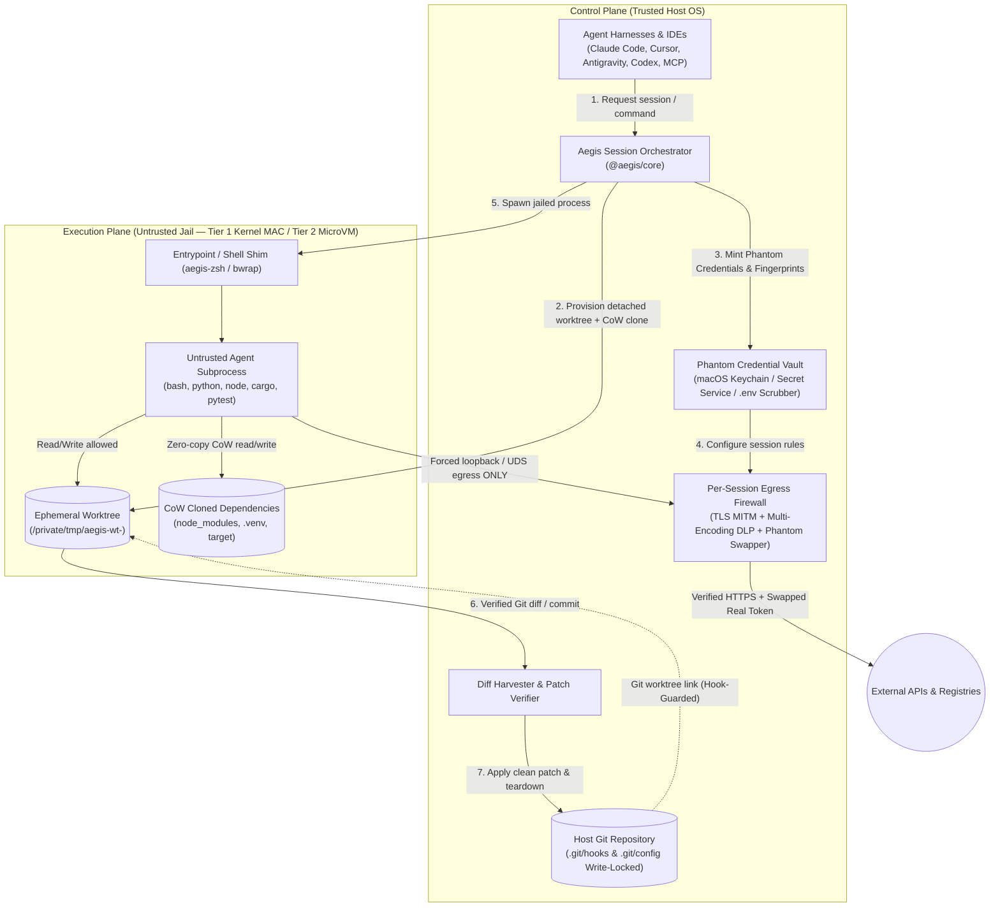
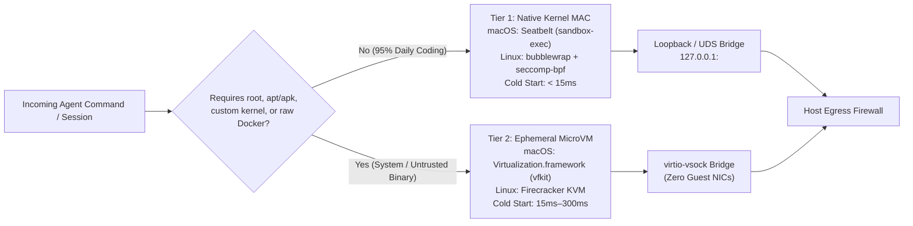
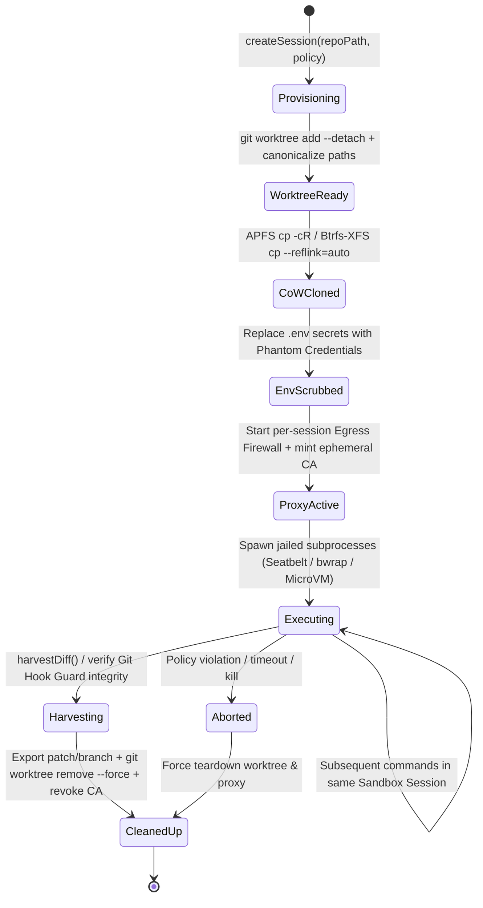
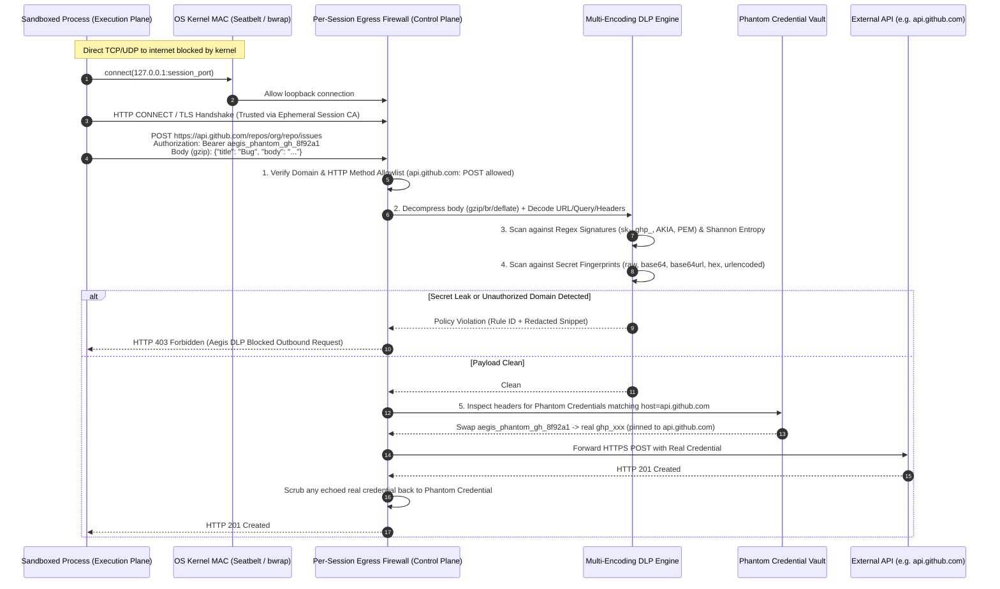
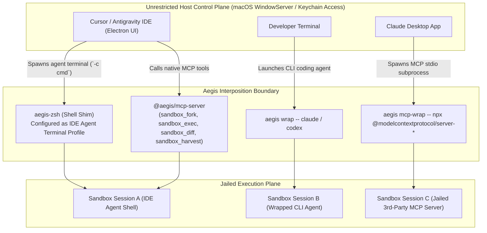
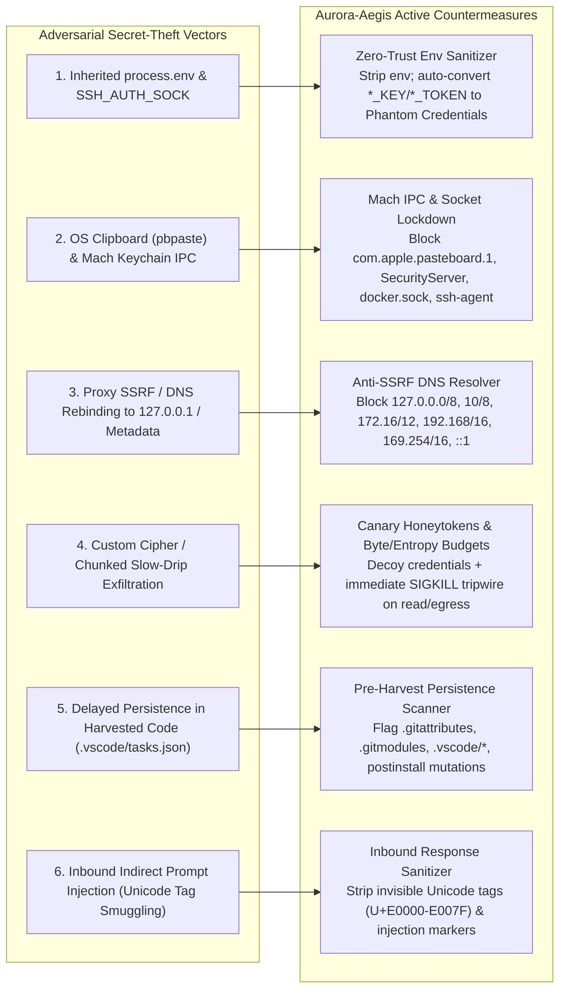

# Aurora-Aegis (`aegis`) — System Architecture Specification

> [!IMPORTANT]
> **Aurora-Aegis** is a zero-latency, kernel-enforced local security boundary and execution runtime for AI coding agents (Claude Code, Codex, Cursor, Antigravity, OpenCode, Claude Desktop). It isolates untrusted agent tool execution into **Ephemeral Worktrees** with **Copy-on-Write (CoW) Clones**, enforces **Default-Deny Home Read** and **Git Hook Guard** kernel policies, and routes all network traffic through a per-session **Egress Firewall** with **Multi-Encoding DLP** and **Phantom Credentials**.

---

## 1. Architectural Improvements Over the Initial Concept

As part of hardening the initial prototype guide into a production-grade security architecture, six critical vulnerabilities and operational bottlenecks have been resolved:

| Area | Vulnerability / Limitation in Initial Draft | Aurora-Aegis Architectural Hardening |
| :--- | :--- | :--- |
| **1. Home Directory Exposure** | `(allow default)` with a 5-folder blocklist (`~/.ssh`, `~/.aws`, etc.) left `~/.kube`, `~/.docker`, `~/.npmrc`, `~/.git-credentials`, and `~/Library/Application Support/*` readable. | **Default-Deny Home Read ([ADR-0003](./adr/0003-default-deny-home-and-git-hook-write-protection.md))**: Deny `file-read*` on the entire `$HOME` tree by default; explicitly allowlist only the canonicalized **Ephemeral Worktree** and read-only toolchain stores (`~/.nvm`, `~/.cargo/registry`, `~/.pnpm-store`). |
| **2. Git Worktree Sandbox Escape** | Granting write access to the repo's `.git` dir allows a jailed script to write a malicious `.git/hooks/post-checkout` or `.git/config` `core.fsmonitor` that executes unsandboxed on the host. | **Git Hook Guard ([ADR-0003](./adr/0003-default-deny-home-and-git-hook-write-protection.md))**: Grant `file-write*` strictly to `<repo>/.git/worktrees/<session-id>` and `<repo>/.git/objects`, while explicitly denying writes to `<repo>/.git/hooks`, `<repo>/.git/config`, and `<repo>/.git/refs/heads/*`. |
| **3. macOS Symlink Policy Bypass** | Seatbelt evaluates canonical kernel vnode paths; rules referencing `/tmp` or symlinked paths silently fail to match `/private/tmp`. | **Mandatory Path Canonicalization**: Every path injected into Seatbelt or `bubblewrap` is resolved via `fs.realpathSync()` prior to policy compilation. |
| **4. Linux `--unshare-net` Loopback Deadlock** | `bwrap --unshare-net` isolates the network namespace so `127.0.0.1:8899` inside the sandbox cannot reach the host's loopback proxy. | **UDS-to-Loopback Bridge ([ADR-0006](./adr/0006-unix-socket-bridge-for-linux-netns-egress.md))**: Bind-mount a per-session host Unix Domain Socket (`egress.sock`) into the unshared Linux namespace and run an in-jail loopback forwarder. |
| **5. Trivial DLP Bypass Vectors** | Only scanning plain-text `POST`/`PUT`/`PATCH` bodies on a static port `8899` missed `GET` query exfiltration, `gzip`/`br` compressed bodies, URL/hex/base64url encodings, and parallel session collisions. | **Per-Session Ephemeral Port + Normalized DLP Pipeline ([ADR-0004](./adr/0004-loopback-mitm-egress-dlp-and-phantom-credentials.md))**: Dynamic per-session proxy ports, URL/header/body scanning, automatic `gzip`/`deflate`/`br` decompression, and multi-encoding **Secret Fingerprints** (raw, Base64, Base64url, hex, URL-encoded). |
| **6. Host `.env` File Exposure** | Copying or mounting `.env` into the worktree lets an agent read secrets and obfuscate them before exfiltration. | **Worktree `.env` Scrubbing & Phantom Synthesis**: Host `.env` files are never copied raw into the **Ephemeral Worktree**; they are replaced with a synthesized `.env` populated with **Phantom Credentials**. |

---

## 2. High-Level System Architecture: Control Plane vs. Execution Plane

Aurora-Aegis strictly separates the **Control Plane** (trusted host process space) from the **Execution Plane** (untrusted, disposable kernel jail or MicroVM).



---

## 3. Dual-Tier Isolation Architecture

Aurora-Aegis selects the **Isolation Tier** per session based on workload requirements ([ADR-0002](./adr/0002-dual-tier-kernel-mac-and-microvm-isolation.md)):



### 3.1 Tier 1: macOS Seatbelt (`sandbox-exec`) Hardened Profile

All interpolated paths (`${REAL_HOME}`, `${REAL_WORKTREE}`, `${REAL_REPO_GIT}`, `${REAL_WORKTREE_GITDIR}`) are resolved via `fs.realpathSync()` prior to profile generation:

```scheme
(version 1)
(allow default)

;; 1. Default-Deny ALL reads and writes under the user's home directory
(deny file-read* file-write*
  (subpath "${REAL_HOME}"))

;; 2. Allow read-only access to non-sensitive toolchain binaries & immutable package caches in $HOME
(allow file-read*
  (subpath "${REAL_HOME}/.nvm")
  (subpath "${REAL_HOME}/.fnm")
  (subpath "${REAL_HOME}/.bun")
  (subpath "${REAL_HOME}/.cargo/bin")
  (subpath "${REAL_HOME}/.cargo/registry")
  (subpath "${REAL_HOME}/.rustup")
  (subpath "${REAL_HOME}/.pyenv")
  (subpath "${REAL_HOME}/.local/share/pnpm")
  (subpath "${REAL_HOME}/Library/pnpm"))

;; 3. Deny ALL disk writes across the entire machine by default
(deny file-write*)

;; 4. Allow read/write inside the Ephemeral Worktree and isolated session temp dirs
(allow file-read* file-write*
  (subpath "${REAL_WORKTREE}")
  (subpath "${REAL_SESSION_TMP}")
  (literal "/dev/null")
  (literal "/dev/zero")
  (literal "/dev/random")
  (literal "/dev/urandom")
  (literal "/dev/tty"))

;; 5. Git Hook Guard: Allow reading shared repo .git metadata, allow writing ONLY to this worktree's gitdir & shared objects
(allow file-read*
  (subpath "${REAL_REPO_GIT}"))
(allow file-write*
  (subpath "${REAL_WORKTREE_GITDIR}")
  (subpath "${REAL_REPO_GIT}/objects"))
(deny file-write*
  (subpath "${REAL_REPO_GIT}/hooks")
  (literal "${REAL_REPO_GIT}/config")
  (literal "${REAL_REPO_GIT}/packed-refs")
  (subpath "${REAL_REPO_GIT}/refs/heads"))

;; 6. Kernel Network Lock: Block all raw sockets, UDP/DNS, and non-proxy traffic
(deny network*)
(allow network-outbound
  (remote tcp "localhost:${SESSION_PROXY_PORT}"))
(allow network-bind
  (local tcp "localhost:*"))
(allow network-inbound
  (local tcp "localhost:*"))

;; 7. Mach IPC, Clipboard, Keychain & Local Daemon Socket Lockdown (ADR-0007)
(deny mach-lookup
  (global-name "com.apple.pasteboard.1")
  (global-name "com.apple.SecurityServer")
  (global-name "com.apple.securityd.xpc")
  (global-name "com.apple.SystemConfiguration.configd"))
(deny file-read* file-write*
  (literal "/var/run/docker.sock")
  (literal "/private/var/run/docker.sock")
  (subpath "/private/tmp/com.apple.launchd"))
```

### 3.2 Tier 1: Linux `bubblewrap` + `seccomp-bpf` + UDS Bridge

On Linux, `bubblewrap` constructs an unprivileged mount, PID, IPC, and network namespace (`--unshare-all`):
* **Filesystem Mounting:**
  * `--ro-bind /usr /usr`, `--ro-bind /lib /lib`, `--ro-bind /lib64 /lib64`, `--ro-bind /bin /bin`, `--ro-bind /etc/resolv.conf /etc/resolv.conf`, `--ro-bind /etc/ssl /etc/ssl`
  * `--tmpfs /home/${USER}` (wipes visibility of the entire host `$HOME` directory)
  * `--ro-bind-try ${HOME}/.nvm /home/${USER}/.nvm` (selective read-only toolchain mounts)
  * `--bind ${REAL_WORKTREE} ${REAL_WORKTREE}` (read-write **Ephemeral Worktree**)
  * **Git Hook Guard via Read-Only Bind Overlays:**
    * `--ro-bind ${REAL_REPO_GIT} ${REAL_REPO_GIT}`
    * `--bind ${REAL_WORKTREE_GITDIR} ${REAL_WORKTREE_GITDIR}`
    * `--bind ${REAL_REPO_GIT}/objects ${REAL_REPO_GIT}/objects`
    * `--ro-bind ${REAL_REPO_GIT}/hooks ${REAL_REPO_GIT}/hooks`
    * `--ro-bind ${REAL_REPO_GIT}/config ${REAL_REPO_GIT}/config`
* **Network Bridge ([ADR-0006](./adr/0006-unix-socket-bridge-for-linux-netns-egress.md)):**
  * Host Egress Firewall listens on `${REAL_SESSION_TMP}/egress.sock`.
  * `bwrap` bind-mounts `--ro-bind ${REAL_SESSION_TMP}/egress.sock /run/aegis/egress.sock`.
  * The sandbox entrypoint spawns a lightweight UDS-to-TCP relay on `127.0.0.1:${SESSION_PROXY_PORT}` inside the isolated network namespace before `exec`-ing the target command.
* **Syscall Filter (`seccomp-bpf`):** Blocks `ptrace`, `kexec_load`, `open_by_handle_at`, `perf_event_open`, `bpf`, `userfaultfd`, `mount`, `umount2`, `pivot_root`, and `keyctl`.

---

## 4. Workspace Lifecycle, CoW Cloning & Harvest State Machine



### Copy-on-Write (CoW) Strategy
To avoid re-running `npm install`, `pnpm install`, `pip install`, or `cargo build` from scratch in every **Ephemeral Worktree**:
1. **Capability Detection:** At startup, `@aegis/core` probes the filesystem housing the repository and worktree directory:
   * **macOS APFS:** Executes `cp -cR <src> <dst>`. Requires `<src>` and `<dst>` to reside on the same APFS volume (e.g., `/private/tmp` and `/Users/...` share the macOS Data volume `/System/Volumes/Data`).
   * **Linux Btrfs / XFS / bcachefs:** Executes `cp -a --reflink=always <src> <dst>`. To ensure same-filesystem reflinks on Linux where `/tmp` is often a `tmpfs` mount, Aurora-Aegis defaults the worktree root to `<repo-parent>/.aegis-worktrees/<session-id>` when `/tmp` is on a different mount point!
   * **Fallback:** Hardlink farm for immutable cache stores or fast parallel copy with warning telemetry.

---

## 5. Egress Firewall, Multi-Encoding DLP & Phantom Credential Swap



### Multi-Encoding Secret Fingerprinting
When a **Sandbox Session** starts, the **Phantom Credential Vault** ingests protected secrets from the host `.env` and configured credential providers. For every secret $S$ with length $\ge 8$:
1. Computes a **Secret Fingerprint** set:
   * `raw`: $S$
   * `base64`: $\text{base64}(S)$ (including trimmed padding variants)
   * `base64url`: $\text{base64url}(S)$
   * `hex`: $\text{hex}(S)$ (lowercase & uppercase)
   * `urlencoded`: $\text{encodeURIComponent}(S)$
2. Strips $S$ from the worktree's `.env` file and replaces it with `AEGIS_PHANTOM_<NAME>_<RANDOM_ID>`.
3. Scans every outbound request's **URL path, query parameters, request headers, and decompressed request body** (supporting `gzip`, `deflate`, `br`, and `zstd`) across **all HTTP methods** (`GET`, `POST`, `PUT`, `PATCH`, `DELETE`, `HEAD`, `OPTIONS`) so an agent cannot exfiltrate secrets via `GET https://allowed-host.com/?q=<base64_secret>`.

---

## 6. Asymmetric Sandboxing: IDE, CLI, and MCP Integration



1. **CLI Outer Wrapper (`aegis wrap -- <agent-cmd>`)**: Launches CLI agents (Claude Code, Codex CLI, OpenCode, Aider) directly inside an **Ephemeral Worktree** and kernel jail so flags like `--dangerously-skip-permissions` or `--full-auto` operate safely.
2. **IDE Shell Shim (`aegis-zsh`)**: When Cursor or Antigravity invokes `/usr/local/bin/aegis-zsh -c "<command>"`, the shim attaches to the active **Sandbox Session** for the workspace (or lazily initializes one), executes the command inside the kernel jail + **Egress Firewall**, and streams `stdout`/`stderr`/exit code back to the IDE.
3. **MCP Config Wrapper (`aegis integrate`)**: Rewrites MCP server entries in `claude_desktop_config.json` or `.cursor/mcp.json` to execute inside `aegis mcp-wrap`, ensuring third-party `npx` or `uvx` MCP servers cannot read `~/.ssh` or exfiltrate host files.

---

## 7. Monorepo Package Architecture & Core Domain Interfaces

```text
Aurora-Aegis/
├── GLOSSARY.md                        # Canonical ubiquitous language
├── package.json                       # pnpm workspace + Turbo / Node >= 22 TypeScript config
├── tsconfig.base.json                 # Strict TypeScript configuration
├── docs/
│   ├── ARCHITECTURE.md                # This system architecture specification
│   ├── AGENT_MILESTONES.md            # AI-agent execution roadmap & verification contracts
│   └── adr/                           # Architectural Decision Records (0001 - 0006)
└── packages/
    ├── core/                          # @aegis/core — Zero-UI domain & runtime engine
    │   └── src/
    │       ├── types/                 # Canonical TypeScript interfaces (contracts.ts)
    │       ├── workspace/             # EphemeralWorktreeManager, CoWCloner, EnvScrubber
    │       ├── drivers/               # SeatbeltDriver (macOS), BwrapDriver (Linux), MicroVMDriver
    │       ├── firewall/              # EgressFirewall, DlpScanner, PhantomVault, EphemeralCA
    │       ├── harvester/             # DiffHarvester, GitHookIntegrityVerifier
    │       └── session/               # SandboxSessionOrchestrator
    ├── cli/                           # @aegis/cli — `aegis wrap`, `aegis-zsh`, `aegis integrate`, `aegis audit`
    ├── mcp-server/                    # @aegis/mcp-server — MCP server for agent-driven sandboxing
    └── red-team/                      # @aegis/red-team — Automated adversarial security verification suite
```

### Canonical TypeScript Domain Contracts (`@aegis/core/src/types/contracts.ts`)

```typescript
export type IsolationTier = 'tier1-kernel-mac' | 'tier2-microvm';
export type HttpMethod = 'GET' | 'POST' | 'PUT' | 'PATCH' | 'DELETE' | 'HEAD' | 'OPTIONS';

export interface EgressDomainRule {
  readonly domain: string; // e.g., "api.github.com" or "*.npmjs.org"
  readonly allowedMethods: readonly HttpMethod[];
}

export interface PhantomCredentialRule {
  readonly envVarName: string;       // e.g., "GITHUB_TOKEN"
  readonly phantomToken: string;     // e.g., "aegis_phantom_gh_9f8a7b"
  readonly realSecret: string;       // Held strictly in Control Plane memory
  readonly allowedHosts: readonly string[]; // e.g., ["api.github.com"]
}

export interface SandboxPolicy {
  readonly sessionId: string;
  readonly repoRootPath: string;     // Must be resolved via fs.realpathSync
  readonly tier: IsolationTier;
  readonly cowDirectories: readonly string[]; // e.g., ["node_modules", ".venv", "target"]
  readonly readOnlyToolchainPaths: readonly string[];
  readonly egressRules: readonly EgressDomainRule[];
  readonly phantomCredentials: readonly PhantomCredentialRule[];
  readonly protectedSecrets: readonly string[];
  readonly timeoutMs: number;
}

export interface CommandResult {
  readonly exitCode: number;
  readonly stdout: string;
  readonly stderr: string;
  readonly durationMs: number;
  readonly blockedEgressEvents: readonly DlpViolationEvent[];
}

export interface DlpViolationEvent {
  readonly timestamp: string;
  readonly method: HttpMethod;
  readonly url: string;
  readonly reason:
    | 'DOMAIN_NOT_ALLOWED'
    | 'METHOD_NOT_ALLOWED'
    | 'PRIVATE_IP_SSRF_BLOCKED'
    | 'SECRET_FINGERPRINT_MATCH'
    | 'REGEX_SIGNATURE_MATCH'
    | 'CANARY_TRIPWIRE_TRIGGERED'
    | 'ENTROPY_QUOTA_EXCEEDED';
  readonly matchedRule: string;
}
```

---

## 8. Active Secret-Theft & Malicious Exfiltration Defense-in-Depth ([ADR-0007](./adr/0007-active-secret-defense-ipc-lockdown-and-canaries.md))

Sophisticated attacks (poisoned `npm`/`pip` packages, malicious MCP servers, or indirect prompt injections) attempt to steal secrets via non-file channels or smuggle delayed payloads back into the host. Aurora-Aegis enforces six specialized counter-exfiltration layers:



1. **Zero-Trust Process Environment & Live Agent Socket Scrubbing (`EnvSanitizer`)**:
   * Never forwards raw `process.env` into the **Execution Plane**.
   * Strips `SSH_AUTH_SOCK`, `GPG_AGENT_INFO`, `DOCKER_HOST`, `AWS_SESSION_TOKEN`, `GITHUB_TOKEN`, and all variables matching secret heuristics (`*_KEY`, `*_TOKEN`, `*_SECRET`, `*_PASSWORD`, `DATABASE_URL`), automatically converting authorized keys into **Phantom Credentials**.
2. **Clipboard, Keychain Mach IPC & Local Socket Lockdown**:
   * Blocks `com.apple.pasteboard.1` (`pbpaste`/`pbcopy`) so a malicious script cannot silently poll passwords copied by the developer from 1Password/Bitwarden.
   * Blocks `com.apple.SecurityServer` and `com.apple.securityd.xpc` so child processes cannot query macOS Keychain via Mach IPC.
3. **Egress Firewall Anti-SSRF & DNS-Rebinding Blackhole**:
   * Before forwarding any request, the **Egress Firewall** resolves the target hostname in the **Control Plane** and blocks connections resolving to loopback (`127.0.0.0/8`, `::1`), RFC1918 private subnets, link-local/cloud metadata (`169.254.169.254`), or local IDE debugging ports (e.g., Chrome DevTools `9222`, local Postgres/Redis).
4. **Canary Honeytokens & Sliding-Window Egress Budgets (`CanaryVault`)**:
   * Plants synthetic **Canary Honeytokens** inside decoy sandbox paths (e.g., `$SESSION_HOME/.aws/credentials`, `$SESSION_HOME/.ssh/id_ed25519`) and decoy env vars.
   * If a sandboxed process opens a decoy file or transmits any $\ge 6$-character slice of a Canary token, the orchestrator immediately sends `SIGKILL` to the entire process group and terminates the **Sandbox Session**.
   * Enforces per-session outbound payload byte quotas and high-entropy query-string rate limits to prevent slow-drip chunked exfiltration.
5. **Pre-Harvest Persistence Vector Scanner (`HarvestSanitizer`)**:
   * Inspects diffs before harvesting for trojaned host-execution triggers: `.gitattributes` (`filter=` commands), `.gitmodules`, `.vscode/tasks.json`, `.vscode/settings.json`, `.idea/workspace.xml`, shell rc files, and `package.json` `preinstall`/`postinstall` scripts.
6. **Inbound Response Sanitizer (Indirect Prompt Injection Defense)**:
   * Scans inbound HTTP responses through the **Egress Firewall** and strips invisible Unicode tag characters (`U+E0000`–`U+E007F`) and zero-width steganographic payloads used to hijack LLM agents via poisoned web pages or registry metadata.

